  

  
  
  

## `// sobre`

Construo sistemas web e desktop **do banco de dados à interface**: APIs, sistemas de gestão, apps desktop e visualização 3D, com testes, deploy em Docker e código que dá para manter.

Venho do chão de fábrica. Conheço a rotina da produção e da manutenção, e quando o sistema precisa conversar com máquinas ou CLPs, já sei como esses dados chegam e o que pode dar errado.

## `// o que eu construo`

| Tipo de sistema | Stack que eu proporia |
|---|---|
| **Sistema de gestão** | React + TypeScript · Node.js ou .NET · PostgreSQL · Docker |
| **App desktop (Windows)** | React no Electron · TypeScript ou .NET · instalador e atualização |
| **Visualização 3D** | Three.js / React Three Fiber · React · web ou desktop |
| **Site ou landing page** | HTML, CSS e JavaScript · SEO · hospedagem e domínio próprio |

## `// projetos recentes`

| Projeto | O que é | Stack |
|---|---|---|
| **App de comissionamento guiado** | App Windows que conduz técnicos passo a passo no ajuste de equipamentos, com ensaios automáticos e relatório | Electron · React · TypeScript |
| **Gêmeo digital 3D para treinamento** | Equipamento industrial simulado em 3D para treinar técnicos sem risco à máquina real | Python · Three.js |
| **Simulador de ambientes industriais em 3D** | Sistema desktop para montar e simular plantas com esteiras, sensores e atuadores em tempo real | Electron · React Three Fiber · TypeScript |
| **Kanban de projetos para equipe** | Quadro na rede interna com login, grupos, dependências entre tarefas e relatório para reunião | Node.js · JavaScript · Docker |
| **Portfólio interativo** | Site com terminal funcional, abas de código e projetos filtráveis | HTML · CSS · JavaScript |

Detalhes, capturas de tela e o terminal interativo estão no **[portfólio](https://yaggoquerino.github.io)**.

## `// stack`

  
  
  
  
  
  
  
  
  
  
  
  
  

## `// como trabalho`

**Conversa inicial** → **escopo e proposta por escrito** → **entregas parciais para você testar** → **deploy e documentação** → **suporte combinado**

---

  Tem um projeto em mente? <a href="https://wa.me/5547999553463"><b>Me chama no WhatsApp</b></a>.

